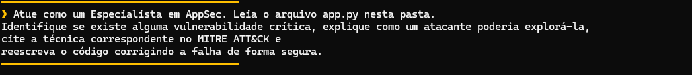
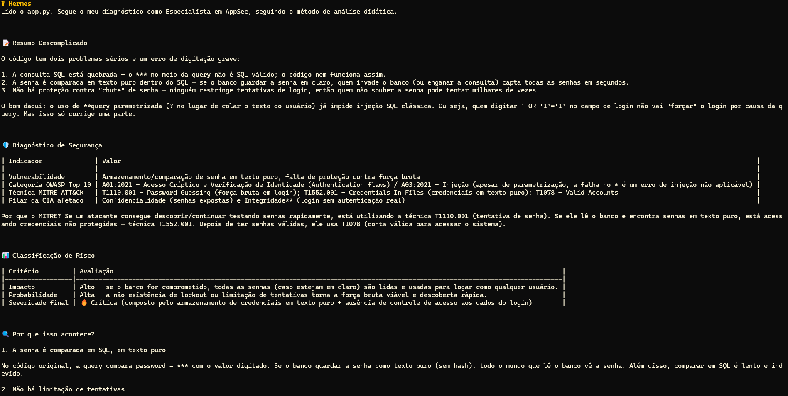
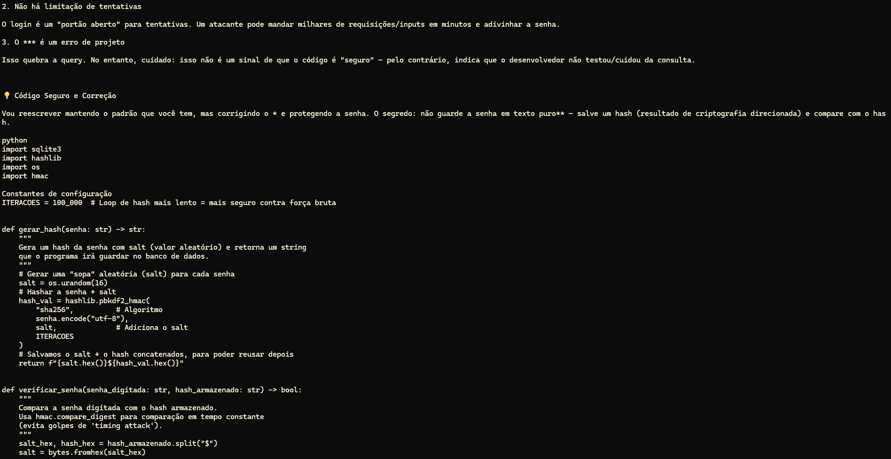
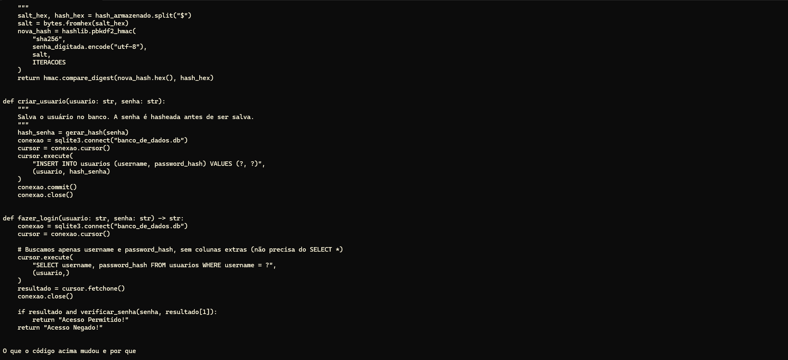
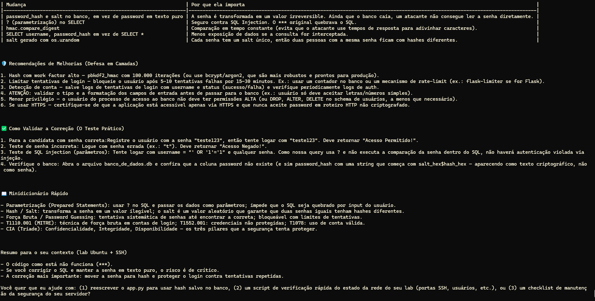
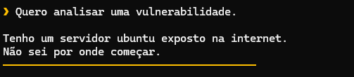
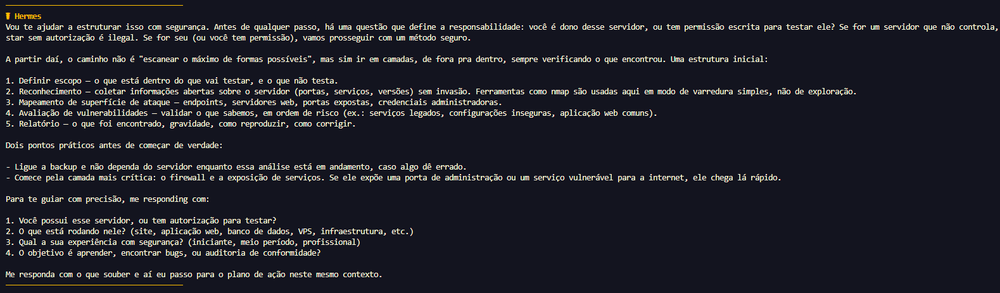
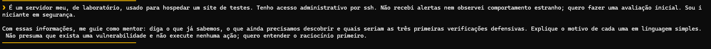
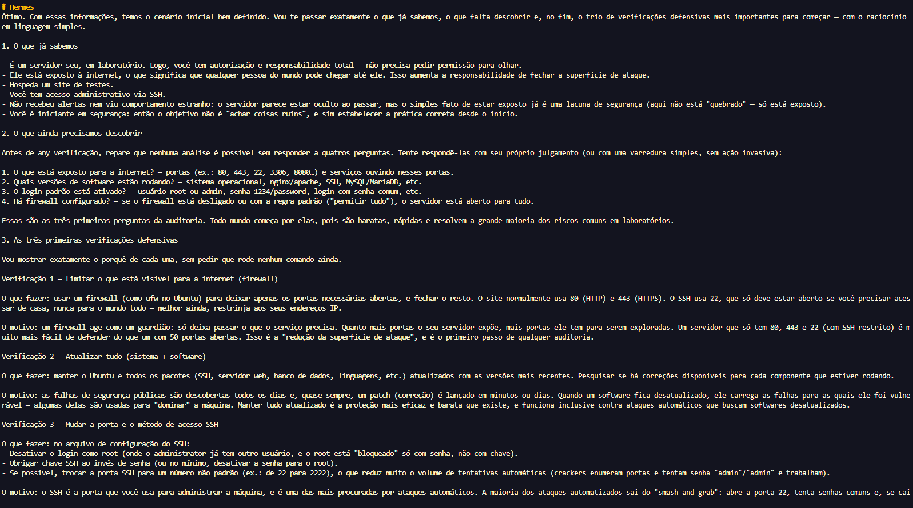
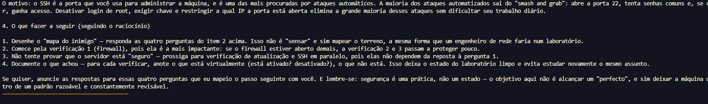

# 🛡️ GuardAI: Especialização do DIO Agent em Cibersegurança e Análise de Vulnerabilidades

Projeto prático desenvolvido para o desafio **GuardAI: Agente Inteligente para Cibersegurança e Análise de Vulnerabilidades** do **Bootcamp Santander - Cibersegurança do Zero à Prática**, promovido pela [DIO](https://dio.me) em parceria com o Santander Open Academy.

O objetivo deste projeto foi transformar o **DIO Agent** em um **mentor de cibersegurança defensiva (AppSec e Infraestrutura)**. Em vez de entregar respostas prontas ou atuar de forma puramente técnica, o agente aprendeu a entender o contexto, mapear riscos por padrões de mercado (OWASP e MITRE ATT&CK), calcular severidade por matriz e orientar correções com testes de validação — tudo isso **sem treinar novos modelos**, apenas especializando arquivos de instrução e conhecimento em Markdown.

---

## 🎯 Por que essa especialização foi criada?

Na era dos assistentes de código com IA, é comum que modelos genéricos apenas gerem trechos de código sem explicar os riscos de segurança ou sem validar se o desenvolvedor realmente compreendeu a causa raiz de uma falha. 

A especialização **GuardAI** foi concebida para:
1. **Adotar uma mentalidade investigativa:** O agente nunca presume nada; ele pergunta sobre o ambiente, tecnologias e permissões antes de sugerir comandos ou diagnósticos.
2. **Desmistificar a segurança:** Explicar termos técnicos complexos com resumos descomplicados e analogias do cotidiano.
3. **Formar profissionais autônomos:** Não entregar a correção pronta de bandeja, mas ensinar a causa raiz e o contra-teste de validação.

---

## 🗂️ Arquivos Criados e Alterados

| Arquivo | Tipo | Descrição da Especialização |
|---|---|---|
| `skills/vulnerability-analysis/SKILL.md` | **Criado** | Roteiro estruturado que ensina o agente a conduzir a análise de vulnerabilidades, matriz de risco e checklist de validação. |
| `skills/vulnerability-analysis/README.md` | **Criado** | Documentação humana explicando o fluxo de 6 etapas da nova skill. |
| `agent/knowledge/security-basics.md` | **Criado** | Base de conhecimento teórica com a Tríade CIA, distinção entre Vulnerabilidade/Ameaça/Risco, OWASP, MITRE ATT&CK e boas práticas defensivas. |
| `agent/persona.md` | **Alterado** | Adicionada a seção de Especialização em Cibersegurança (postura investigativa, ética e foco estritamente defensivo). |
| `AGENTS.md` | **Alterado** | Registrada a nova skill na tabela oficial e incluído o novo documento de segurança na base de conhecimento. |
| `skills/README.md` | **Alterado** | Atualizado o catálogo geral de skills disponíveis no projeto. |
| `agent/app.py` | **Criado** | Script de laboratório contendo a simulação de login (vulnerável vs. consulta parametrizada). |

---

## 🚀 Como Rodar o Agente no Harness (Hermes / VS Code)

1. Clone o repositório ou baixe os arquivos:
   ```bash
   git clone https://github.com/SEU_USUARIO/SEU_REPOSITORIO.git
   cd dio-agent
   ```
2. Abra o terminal na pasta raiz do projeto.
3. Inicie o harness do agente:
   ```bash
   hermes
   ```
4. O agente lerá automaticamente o arquivo `AGENTS.md` e estará pronto para responder como GuardAI!

---

## 💡 A Melhoria Escolhida (Ideias para Evoluir)

Como evolução recomendada pelo edital do desafio, foram implementadas três melhorias principais na skill:
1. **Matriz Padronizada de Avaliação de Risco:** O agente calcula a severidade final cruzando **Impacto** com **Probabilidade/Explorabilidade** (Crítica, Alta, Média, Baixa), justificando a classificação.
2. **Mapeamento Obrigatório com Padrões Globais:** Toda análise de código deve identificar a categoria do **OWASP Top 10** (ex: *A03:2021 – Injection*) e o código da técnica do **MITRE ATT&CK** (ex: *T1190 – Exploit Public-Facing Application*).
3. **Resumo Descomplicado e Minidicionário:** Obrigatoriedade de iniciar com uma analogia simples para iniciantes e manter um glossário rápido para termos como *Payload*, *Hash* e *Bypass*.

---

## 📸 Evidências Práticas (Testes e Validação)

### 1. Análise de Código e Mitigação de SQL Injection (`app.py`)

Apresentou-se ao agente uma função de login vulnerável por interpolação de f-string. O agente diagnosticou o SQLi, explicou a exploração com o payload `' OR 1=1 --`, mapeou a técnica no MITRE ATT&CK (T1190 / CWE-89) e comprovou a mitigação através de consulta parametrizada:
- **Código Original com Payload:** `Acesso Permitido` ❌
- **Código Corrigido com Payload:** `Acesso Negado` ✅

#### 🔹 Prompt de Análise de Código


#### 🔹 Diagnóstico da Falha e Explicação de Exploração


#### 🔹 Mapeamento MITRE ATT&CK e Kill Chain


#### 🔹 Correção Aplicada com Consulta Parametrizada


#### 🔹 Recomendações em Camadas e Verificação Prática


---

### 2. Postura Investigativa e Ética (Servidor Ubuntu Exposto)

Ao ser provocado com um cenário aberto (*"Tenho um servidor Ubuntu exposto na internet, não sei por onde começar"*), o agente:
- Exigiu a confirmação de autorização e propriedade do servidor antes de sugerir ações;
- Estruturou o processo em camadas (Definição de escopo, Reconhecimento passivo, Mapeamento e Relatório);
- Fez 4 perguntas de contexto para entender a arquitetura sem emitir comandos cegos.

#### 🔹 Prompt Inicial do Estudante


#### 🔹 Resposta com Alerta Ético, Metodologia e Perguntas de Contexto


---

### 3. Mentoria Consultiva em Infraestrutura Defensiva

Ao receber o contexto do servidor de laboratório, o agente estruturou uma análise clara dividida em:
1. **O que já sabemos:** Responsabilidade total, servidor exposto, ausência de anomalias no momento.
2. **O que precisamos descobrir:** Portas ativas, serviços/versões, credenciais padrão e regras de firewall.
3. **Três primeiras verificações defensivas:**
   - **Firewall (UFW):** Redução drástica da superfície de ataque liberando apenas portas essenciais.
   - **Atualização contínua:** Aplicação de patches contra vulnerabilidades conhecidas (CVEs).
   - **Hardening de SSH:** Bloqueio do usuário root, troca de porta padrão e autenticação exclusiva por par de chaves criptográficas.

#### 🔹 Contexto do Laboratório Fornecido pelo Estudante


#### 🔹 Análise Inicial e Primeira Verificação Defensiva (Portas e Superfície)


#### 🔹 Verificações 2 e 3 (Patches, SSH), Contra-teste e Próximos Passos


---

## 🎓 Conclusão

O projeto comprovou na prática que é possível criar um assistente especializado em segurança altamente eficaz sem a necessidade de treinamento de pesos de redes neurais (*fine-tuning*). Através de uma arquitetura limpa de **Skills**, **Knowledge** e **Persona**, o DIO Agent se tornou um mentor de cibersegurança completo, responsável e alinhado aos mais altos padrões do mercado de tecnologia.
